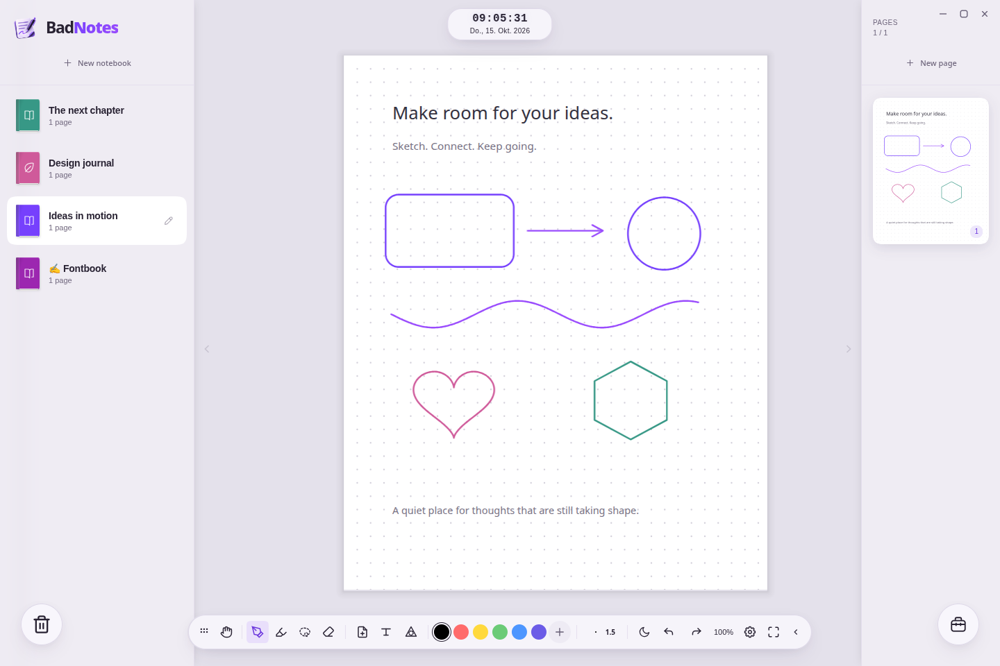

<p align="center">
  
</p>

<h1 align="center">BadNotes</h1>

<p align="center"><strong>Your handwriting. Your space.</strong></p>

<p align="center">
  <a href="https://github.com/Hot-Sweeper/badnotes-desktop/releases"></a>
  <a href="https://github.com/Hot-Sweeper/badnotes-desktop/actions/workflows/ci.yml"></a>
  <a href="LICENSE"></a>
  
</p>

<p align="center">
  <a href="https://github.com/Hot-Sweeper/badnotes-desktop/releases"><strong>Try the first alpha →</strong></a> &nbsp; · &nbsp;
  <a href="#run-from-source">Run from source</a> &nbsp; · &nbsp;
  <a href="https://github.com/Hot-Sweeper/badnotes-desktop/issues">Report a bug</a>
</p>

---

> **First public alpha.** Expect rough edges. Back up important notes before testing. Cross-platform packages are built in CI; pen hardware and desktop integration still need real-device testing, especially on Windows and macOS.

BadNotes is basically my open-source, vibecoded take on Goodnotes, aiming for less bloat. You can write, sketch, type in your own handwriting, and lasso things around in a purple-and-pink workspace. Arrange pages into notebooks that stay on your machine. The trash animation may have become a side quest.

This is an independent project and isn't affiliated with Goodnotes.

<p align="center"></p>

## Highlights

- Pressure-aware ink, highlighters, erasing, and undo/redo
- A lasso for selecting, moving, resizing, and rotating ink and images
- Editable geometry, shape tools, and sketch recognition
- Custom notebook covers, emblems, colors, and drag-to-reorder shelves
- Resizable pages with live previews, dotted, ruled, grid, and blank paper
- Image import, notebook JSON import/export, and a recoverable recycling bin
- Light, dark, and OLED modes, with six interface tones
- Momentum-based navigation, elastic shelves, and animated drag-and-drop
- A floating, customizable toolbar and keyboard shortcuts
- Optional AI assistance with your own API key; basic note-taking needs no account

## Download

Get test builds from [GitHub Releases](https://github.com/Hot-Sweeper/badnotes-desktop/releases).

| Platform | Package |
| --- | --- |
| Windows x64 | `.exe` installer |
| Linux x64 | `.AppImage` and `.deb` |
| macOS | `.dmg` and `.zip`; choose the architecture matching your Mac |

Downloads include Electron and the Python backend. You do not need to install Node.js or Python to use a packaged build. Builds are currently unsigned and macOS builds are not notarized; Windows SmartScreen or macOS Gatekeeper may warn or block them. Building from source is an alternative.

Linux AppImages may require FUSE 2, or can be extracted with `--appimage-extract` and started with `squashfs-root/AppRun`. Do not run BadNotes as root or disable Electron's sandbox to work around installation issues.

## Run from source

Requirements: **Node.js 22.12+**, npm, **Python 3.12**, and Git.

```bash
git clone https://github.com/Hot-Sweeper/badnotes-desktop.git
cd badnotes-desktop
python -m venv .venv
```

Install Python dependencies using the virtual environment:

```bash
# Linux / macOS
.venv/bin/python -m pip install -r requirements-lock.txt

# Windows PowerShell
.venv\Scripts\python.exe -m pip install -r requirements-lock.txt
```

Then, on any platform:

```bash
npm ci
npm start
```

Use `python3.12` or the Windows `py -3.12` launcher instead of `python` if needed. If you use another environment, set `BADNOTES_PYTHON` to its absolute Python executable path.

## Your notes stay yours

The app stores notebooks, page JSON, images, fonts, and trash on your device:

| Platform | Default data directory |
| --- | --- |
| Windows | `%APPDATA%\BadNotes\data` |
| Linux | `~/.config/BadNotes/data` (or `$XDG_CONFIG_HOME/BadNotes/data`) |
| macOS | `~/Library/Application Support/BadNotes/data` |

Back up the **entire data directory** while the app is closed. Set `BADNOTES_DATA_DIR` to use another location. Older development copies used a `data/` folder beside `app.py`; the public release never imports or overwrites that folder automatically. Copy it to the new data location yourself, with both apps closed, after making a backup.

The desktop backend listens only on loopback, uses a random port, and requires a per-launch session token. It is not a hosted multi-user service. Phone scanning over your LAN is not enabled in this alpha.

## Optional integrations

Copy `.env.example` to `.env` in the app's configuration directory (the parent of `data` above), then restart BadNotes. Source desktop sessions use this same location. Browser-only development (`python app.py`) can read `.env` beside `app.py`.

- **AI assistant:** set `COMET_API_KEY` and optionally `COMET_API_BASE`. Only invoked AI requests send their included text/images to the configured provider; provider usage may cost money. Keys stay in the backend. The current model menu is provider-specific.
- **Calendar:** set `BADNOTES_CALENDAR_URL` to your HTTPS iCalendar feed and `BADNOTES_CALENDAR_TIMEZONE` to an IANA timezone, such as `Europe/Berlin`. No calendar requests are made by default. The first parser handles timed events, not recurrence expansion or all-day events.
- **AI math display:** downloads KaTeX from jsDelivr when first needed. Core note-taking works offline.

Never commit `.env`, API keys, personal notebooks, or handwriting samples.

## Build packages

Install build dependencies in the same virtual environment:

```bash
# Linux / macOS
.venv/bin/python -m pip install -r requirements-build.txt

# Windows
.venv\Scripts\python.exe -m pip install -r requirements-build.txt
```

```bash
npm run check
npm test
npm run pack

# Build on the target OS and architecture:
npm run dist:linux
npm run dist:win
npm run dist:mac
```

Packages go to `dist/`. PyInstaller bundles the backend before Electron Builder packages the app. Build on each target OS/architecture: copying a Linux backend into a Windows or macOS package will not work. The release workflow handles native builds and checksum generation.

Debian packaging also needs the compatibility libraries used by Electron Builder's FPM helper (for example, `libxcrypt-compat` on Arch-based build hosts). Official Linux builds use Ubuntu 22.04 runners.

## Development

```text
electron/         Desktop shell, window controls, optional Linux input helpers
app.py            Notebook, image, font, scan, and optional AI APIs
templates/        Workspace and scanner views
static/js/        Canvas engine, tools, UI, and physics
static/css/       Themes and interface components
scripts/          Portable backend launcher, build and verification tools
tests/            Unit tests and interactive regression checks
```

The optional Linux raw-input helper needs system Python 3. KDE/Wayland geometry observation additionally uses PyGObject. If unavailable, input falls back to native Chromium events. Hardware-specific raw-input permissions are opt-in; no udev rules or input-group membership changes are installed automatically.

See [CONTRIBUTING.md](CONTRIBUTING.md), [SECURITY.md](SECURITY.md), and the [third-party notices](THIRD_PARTY_NOTICES.md).

## License

[MIT](LICENSE)

---

<p align="center"><sub>Built by <a href="https://github.com/Hot-Sweeper">Mr. Lemon</a> · <a href="https://github.com/Hot-Sweeper/still-browser">Still Browser</a> · <a href="https://github.com/Hot-Sweeper/peak-and-peak-studio">Peak &amp; Peak Studio</a></sub></p>
